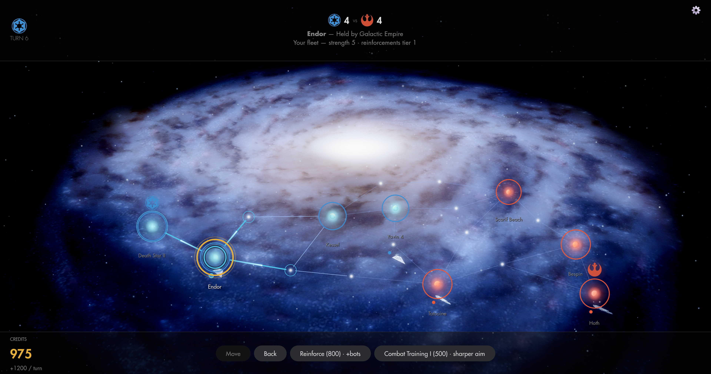
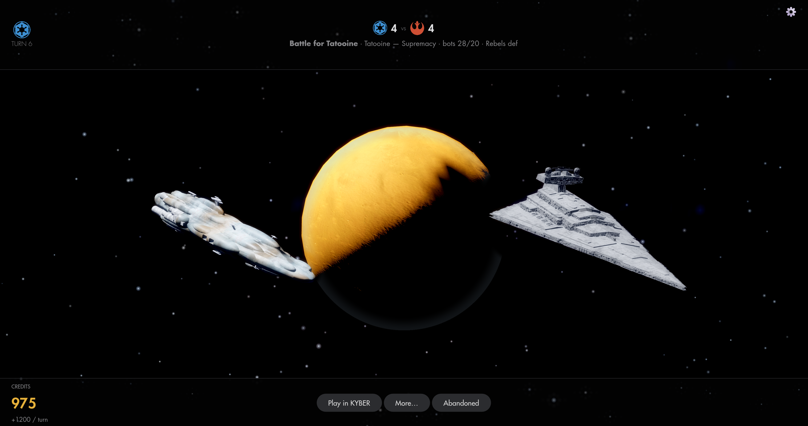

# Star Wars Battlefront II (2017) Galactic Conquest

## A strategic campaign layer for STAR WARS Battlefront II (2017)

Taking inspiration from the original STAR WARS Battlefront II (2005), this mod implements a full-on strategy game mode outside of matches where you take control of a faction, build your fleets, and fight for control of planets. When you or the enemy faction come into contact with each other, battles are fought and resolved in real Battlefront II matches played and controlled through [KYBER](https://kyber.gg) or set up by hand in Offline mode using an [Instant Action](https://www.nexusmods.com/starwarsbattlefront22017/mods/13320) mod. [Battlefront+](https://www.nexusmods.com/starwarsbattlefront22017/mods/7592) is strongly recommended for full compatability.

There are three campaigns: **Clone Wars**, **Galactic Civil War**, and the **Sequel Era**.
Play solo against an AI opponent, online with friends (experimental), or split-screen co-op locally (requires [a split-screen mod](https://www.nexusmods.com/starwarsbattlefront22017/mods/719)), and choose between Easy, Normal, and Hard difficulties (affects AI credits and behavior).

In Single-Player mode, the enemy faction is controlled by the AI, and all battles are fought against bots. A mod to improve multiplayer bot behavior is **STRONGLY** recommended, otherwise bots will not fight correctly or use special units and heroes. Galactic Conquest was made with [Battlefront+](https://www.nexusmods.com/starwarsbattlefront22017/mods/7592) in mind (which does this), but it also works with [Instant Online Improvements](https://www.nexusmods.com/starwarsbattlefront22017/mods/3658) if you prefer a more vanilla experience. 

The Galactic Conquest program was built from the ground up in Godot and is packaged as a standalone .exe. It also has controller support built in, but you will need to switch windows using a keyboard and mouse.

# An Automated Galactic Conquest Campaign
KYBER is recommended for full functionality. Galactic Conquest uses a KYBER plugin to switch maps, set modes, adjust bot counts, set bot difficulty, and read match results directly to your campaign. There are a few limitations to this implementation which are detailed below.

# Gameplay
This mod, in an effort to add variety and flow to the campaign, uses a combination of different game modes depending on what type of battle is being fought. 
- **Supremacy** matches are fought for any planetary battle where two fleets converge. Capitol ship boarding is removed from Supremacy so matches don't go on too long.
- **Galactic Assault** is fought on a variety of maps when a fleet attacks a planet that has no fleet defending it. Galactic Assault is also fought on every home world for a cinematic finish to a campaign.
- For maps where Galactic Assault or Supremacy aren't available, a combination of **Co-op** and **Blast** modes are used instead.

## Space Battles
When two fleets converge in space between planets, **Co-op Attack/Defend** matches will play out, with the attacker boarding the defender's capitol ship to destroy it (Excludes Galactic Civil War campaign, see below).

# Limitations
- Galactic Conquest is able to control your server through KYBER, but it is unable to start a server. Before you start any battle, **you must Host a server with KYBER**. Once the server is up, Galactic Conquest will take control when you start a battle.
- Co-op matches do not report results to the Galactic Conquest program. It will instead ask you for a result once the match is finished.
- Online multiplayer (experimental) uses UPnP to connect the client to the host. If UPnP is unavailable on either end, port forwarding is used, but this requires adjusting port forwarding settings in your router (yuck).
- Starfighter Assault is not supported. Mods do not improve the AI behavior on these matches, so they were purposefully left out.
- Space battle co-op matches are only available in the Clone Wars and Sequel Era campaigns, as those were the only eras DICE developed capitol ship maps for. For Galactic Civil War space battles, a match of Blast on the nearest planet will be fought instead.
- Supremacy matches end just before the "capitol ship" phase takes place. When capitol ship boarding is triggered, the match will end and load the next map. Results are reported through in-game chat as well.
- Online multiplayer will do its best to put players on correct teams, but it may not be perfect. You may need to adjust players/teams through KYBER.
- In online multiplayer matches on co-op, players should be switched to the appropriate team. However, objective messages and on-screen text may appear incorrect since they are defending on an "Attack" Co-op match or attacking on a "Defense" Co-op match.
- Probably some bugs and crashes. Sometimes KYBER may not load your server with mods and you will need to reset it, etc. etc.

If the program isn't able to determine a match result for whatever reason, you can enable the "Show the More... KYBER debug menu" option in the Debug menu. This will give you the ability to manually select who won a match.

# Installation
- Download and install [KYBER](https://kyber.gg) (unless you want to set up matches manually using [Instant Action](https://www.nexusmods.com/starwarsbattlefront22017/mods/13320)).
- In KYBER, proceed to set up and and download either [Battlefront+](https://www.nexusmods.com/starwarsbattlefront22017/mods/7592) or [Instant Online Improvements](https://www.nexusmods.com/starwarsbattlefront22017/mods/3658) for bot support.
- Download the latest .exe from [releases](https://github.com/tezla55/galactic-conquest/releases) and run it.
- Launch the .exe file. While setting up a campaign, it will launch KYBER with a custom plugin.
- Host a server in KYBER with the mods you want.

## Enjoyed the mod?
Feel free to [buy me a coffee :)](https://buymeacoffee.com/drtezla)

# AI Disclaimer
This mod was made with the assistance of Claude. That being said, every build was tested by a real human being with hands on a controller/keyboard. Game balance was adjusted manually by a human and every feature was implemented with a human in the loop reviewing, testing, and pushing back. Textures, models, and other elements were made by real human beings as well (see credits below).

# Credits

**Models**
- Starkiller Base — [GrizzleSyrens](https://sketchfab.com/grizzlesyrens)
- Imperial-class Star Destroyer — [Heataker](https://sketchfab.com/Heataker)
- Mon Calamari cruiser — [StarWars-Universe](https://sketchfab.com/SWU)
- Republic Venator-class Star Destroyer — [Commander Cody](https://sketchfab.com/CaptainMiguel)
- Death Star II — [N8](https://sketchfab.com/nathanmlange)

**Planet and sky textures**
- Hoth, Endor, Felucia, Geonosis, and Kashyyyk — [Darth Vader666](https://www.moddb.com/members/darthvader666)
- Scarif — [northlogic](https://sketchfab.com/northlogicvfx) (*Dark Water Planet — 8K Textures*)
- Tatooine and Jakku — [Rob Tuytel / Poly Haven](https://polyhaven.com/a/aerial_beach_02) (*aerial_beach_02*, CC0)
- Naboo — [Shiny Man](https://shinyman.artstation.com) (*Exotic Planet 01*)
- Takodana — [Shiny Man](https://shinyman.artstation.com) (*Terran Planet 09*)
- Bespin, Yavin 4, and Kessel — [Screaming Brain Studios](https://screamingbrainstudios.com/) (*Planet Texture Pack*, CC0)
- Kamino and the starfield backdrop — [Solar System Scope](https://www.solarsystemscope.com/textures/) (CC BY 4.0)
- Milky Way galaxy texture — NASA/JPL-Caltech/R. Hurt (SSC), public domain

> **Code only repository.** Bulk planet art (`ui/art/`), 3D models (`3D/`), UI star photos
> (`ui/Stars/`), sounds not tracked here since they are made by other people. Packaged builds
> are attached to GitHub Releases.

*Galactic Conquest is an unofficial, non-commercial fan project. It is not affiliated with, endorsed by, or sponsored by Lucasfilm, Disney, Electronic Arts, DICE, or KYBER. STAR WARS and related names are trademarks of their respective owners.*
